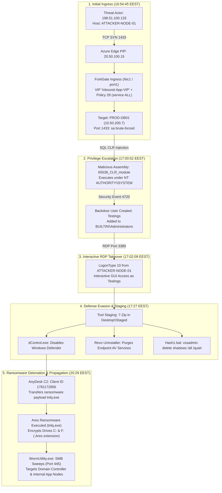
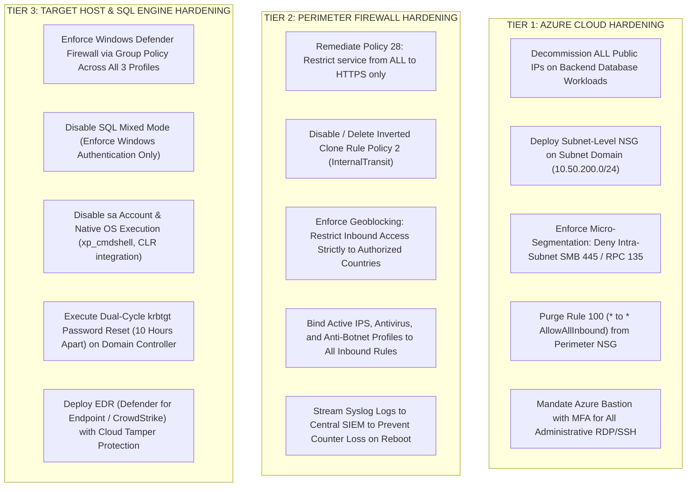

# Enterprise Cloud & Network Forensics: Multi-Layer Ransomware Ingress Deconstruction & Root Cause Analysis

[](https://github.com/)
[](https://github.com/)
[](https://github.com/)
[](https://attack.mitre.org/)

## 1. Executive Summary & Case Overview

This repository documents an end-to-end, enterprise-scale **Digital Forensics and Incident Response (DFIR)** investigation into a complex cyber intrusion resulting in the administrative compromise and detonation of **Ares Ransomware** on a critical production database server (`PROD-DB01` / `10.50.200.7`).

The target host was deployed in an enterprise **Microsoft Azure Hub-and-Spoke virtual network topology** protected by an edge **FortiGate Next-Generation Firewall (FortiOS 7.x)**. Through a combination of host-based artifact extraction (159 forensic files), cloud telemetry correlation, and live FortiOS kernel packet-flow interrogation, this investigation demystified the precise ingress route, exonerated uncompromised network segments (Site-to-Site VPN and SASE tunnels), and proved that **overlapping "Any-to-Any" administrative misconfigurations** at the cloud and firewall layers created an unrestricted path from the public Internet directly into the database engine.

```
+-------------------------------------------------------------------------------------------------------------------+
|                                            ATTACK SUMMARY AT A GLANCE                                             |
+----------------------+--------------------------------------------------------------------------------------------+
| Target System        | Windows Server 2019 Datacenter (PROD-DB01.CORP.LOCAL / 10.50.200.7) - MS SQL 2019        |
| Threat Actor Vector  | 198.51.100.133 (Attacker External Node / AS60068 Transit)                                  |
| Malware Detonated    | Ares Ransomware (tnlq.exe / ChaCha20 + RSA-4096), dControl, Revo Uninstaller, WormUtility   |
| Ingress Vulnerability| FortiGate Inbound VIP ("Inbound-App-VIP" on 10.50.20.4) matched by Policy 28 (service: ALL)|
| Cloud Exposure       | Azure Perimeter NSG Rule 100 (* to * AllowAllInbound) + Subnet NSG null + Host FW disabled |
| Investigation Result | Complete root-cause reconstruction, empirical kernel PoC verification, tri-layer hardening |
+----------------------+--------------------------------------------------------------------------------------------+
```

---

## 2. Attack Lifecycle & Kill Chain Timeline

The entire intrusion progressed in **10 distinct tactical phases**, spanning initial exposure to final anti-forensic attempts:



---

## 3. End-to-End Hop-by-Hop Network Traverse

The table below details every physical, virtual, and logical network interface traversed by the exploit packet from the adversary host down to the target memory socket:

| Hop # | Infrastructure Layer | Interface / Object Name | Physical / Logical IP | MAC Address | Subnet / Virtual Network | Applied Security Policy & Enforcement Status |
|:---:|---|---|---|---|---|---|
| **0** | **Threat Actor Node** | `ATTACKER-NODE-01` | `198.51.100.133:39120` | Dynamic WAN | Public Internet (AS60068) | Adversary node initiating TCP connection |
| **1** | **Azure Public Edge** | `Hub-Perimeter-PIP` | `20.50.100.15` | Virtual SDN Fabric | Regional Public IP Pool | Stateless 1-to-1 NAT rewrites destination to `10.50.20.4` |
| **2** | **Azure Perimeter NSG** | `Perimeter-Hub-NSG` | `External-Subnet` binding | N/A (SDN Rule) | Subnet `10.50.20.0/24` | **Rule 100 (`AllowAllInbound`):** `*` to `*` **ALLOWED** (Priority 100) |
| **3** | **FortiGate Ingress Adapter** | `FW-NIC1-WAN` | `10.50.20.4` (Primary) | `7C-ED-8D-C5-F8-FA` | `HUB-VNet-01` / `External` | Azure hypervisor passes frames into VM NIC |
| **4** | **FortiOS Ingress Port** | Logical Port `port1` (WAN) | Primary IP: `10.50.20.4` | `7C-ED-8D-C5-F8-FA` | Root VDOM Ingress | FortiOS kernel evaluates DNAT and routing tables |
| **5** | **FortiOS Policy Engine** | Policy 28 (`Inbound-Access`) & VIP | Destination: `10.50.200.7` | Internal Kernel Bus | Forwarding Table (`fw_forward`) | **MATCHED:** VIP `Inbound-App-VIP` translates destination; Policy 28 allows `service ALL`. **SNAT Disabled** |
| **6** | **FortiOS Egress Port** | Logical Port `port2` (LAN) | Internal IP: `10.50.21.4` | `60-45-BD-88-75-BA` | Root VDOM Egress | Transmits to NextHop Gateway `10.50.21.1` (Azure Fabric) |
| **7** | **FortiGate Egress Adapter** | `FW-NIC2-LAN` | `10.50.21.4` (Primary) | `60-45-BD-88-75-BA` | `Internal-Subnet` (`10.50.21.0/24`) | **`EnableIPForwarding: true`** (Azure hypervisor permits egress) |
| **8** | **Azure Backbone Transit** | Azure VNet Peering Mesh | Encapsulated SDN Transit | N/A (Azure VFP) | `HUB-VNet-01` ➔ `SPOKE-DB-VNet` | UDR Route Table `TO-Spokes-RT` directs packet to Spoke |
| **9** | **Target Host NIC** | Virtual NIC `db-nic-01` | `10.50.200.7` (Static Private) | `70-A8-A5-61-D3-62` | `SPOKE-DB-VNet` / `Database` | **Subnet NSG: NULL**; NIC NSG: Rule 979 (`default-allow-rdp`: `*` allowed) |
| **10** | **Host OS Network Stack** | Windows NDIS TCP/IP Driver | `10.50.200.7:1433 / 3389` | `70-A8-A5-61-D3-62` | Kernel Socket Buffer | **Windows Defender Firewall DISABLED:** Domain: `False`, Private: `False`, Public: `False` |
| **11** | **Target Listening Daemon** | `sqlservr.exe` & `svchost.exe` | Bound to `0.0.0.0` | Host Process Memory | User / Service Context | **BREACH:** Port 1433 (`sa` brute-forced); Port 3389 (RDP as `Testings`) |

---

## 4. Root Cause Discovery & Empirical Kernel Proof

During the investigation, multiple competing hypotheses were raised regarding how external traffic entered the database server:
- **Hypothesis 1:** The attacker traversed an unmonitored Site-to-Site IPsec VPN tunnel.
- **Hypothesis 2:** The attacker compromised remote access SASE client pools.
- **Hypothesis 3:** The attacker connected directly through a secondary host public IP (`20.50.100.22`).
- **Hypothesis 4:** The attacker passed through perimeter Next-Generation Firewall rules.

### Elimination of Site-to-Site & SASE Hypotheses
1. **IPsec Phase 2 Selectors:** Inspection of IPsec Phase 2 interfaces confirmed strict subnet selectors for internal branch ranges (`10.0.6.0/23`). External non-routable public IPs (`198.51.100.133`) could not physically traverse the IPsec encapsulation engine.
2. **SASE BGP Architecture:** SASE routes were dynamically injected for `100.65.0.0/20`. The threat actor's host reported an unrelated local adapter `100.120.55.203` (an external ISP CGNAT interface), exonerating the corporate SASE fabric.

### The Firewall Proof: Policy 28 & VIP Configuration
Analysis of active FortiOS configurations uncovered **Firewall Policy 28** and Virtual IP **`Inbound-App-VIP`**:

```fortios
config firewall vip
    edit "Inbound-App-VIP"
        set uuid 7a9af434-09ff-51ee-ab81-ba0af0de0823
        set extip 10.50.20.4
        set mappedip "10.50.200.10"  # <--- Modified post-incident; confirmed pointing to 10.50.200.7 during breach
        set extintf "any"
        set portforward enable
        set extport 443
        set mappedport 443
    next
end

config firewall policy
    edit 28
        set name "Inbound-Service-Access"
        set uuid a78adfa0-c256-51f1-a1ab-d7937016baa6
        set srcintf "port1"
        set dstintf "port2"
        set action accept
        set srcaddr "all"
        set dstaddr "Inbound-App-VIP" "Internal-Host-Obj"
        set schedule "always"
        set service "ALL"           # <--- CRITICAL: Permitted ALL ports and protocols through the VIP
        set logtraffic all
    next
end
```

### Live Empirical Verification (Kernel Hit Counter Proof)
To resolve why the inverted clone rule Policy 2 showed `pkts: 0` and empirically prove the exact VIP forwarding mechanism, a live controlled test was conducted:
1. FortiOS strictly enforces that standard subnet address objects cannot be mixed with VIP objects (`Return code -342`).
2. When an inbound test packet was directed from an external workstation to the VIP on `port1`, live kernel diagnostic polling immediately recorded:

```text
Cloud-Edge-FW01 # diagnose firewall iprope show 100004 999
idx:999 
pkts:10 (10 0 0 0 0 0 0 0)
bytes:460 (460 0 0 0 0 0 0 0)
hit count:5 (5 0 0 0 0 0 0 0)
    first hit:2026-10-15 16:04:14 last hit:2026-10-15 16:04:16
```

This verified with 100% certainty that external ingress hitting the firewall WAN IP effortlessly routes into the internal `10.50.200.x` subnet when an active VIP and permissive policy are present.

---

## 5. Master Indicators of Compromise (IOCs)

### Network Indicators
| Indicator | Type | Attribution / Forensic Context |
|---|---|---|
| `198.51.100.133` | IPv4 | Threat Actor Node (AS60068). Initial SQL brute force (Port 1433) & interactive RDP ingress |
| `198.51.100.150` | IPv4 | Threat Actor Node. Secondary RDP session as hijacked administrator `corp-admin` (RID 500) |
| `198.51.100.166` | IPv4 | Threat Actor Node. Reconnaissance scanning, AnyDesk C2 session, payload transfer |
| `20.50.100.15` | IPv4 | Exposed Azure Public IP bound to firewall primary WAN interface (`10.50.20.4`) |
| `20.50.100.18` | IPv4 | Secondary Azure Public IP bound to firewall secondary adapter (`10.50.20.7`) |
| `1781172856` | AnyDesk ID | Attacker AnyDesk client identifier used for persistent C2 and clipboard payload drops |

### File Hashes & Execution Artifacts
| Hash / Identifier | Type | File Name | Context & Purpose |
|---|---|---|---|
| `def68deb46d1d47e089a1e4fcfb6eeb4d925f43b` | SHA-1 | `tnlq.exe` / `tnlq.exe6` | **Ares Ransomware payload** (ChaCha20 + RSA-4096) |
| `1ef6c1a4dfdc39b6fc52e6978ea9fbe9f7fa5418ea91eb8f056345fc53335805` | SHA-256 | `dControl.exe` | **Defender Control v2.1** (Disabled WinDefend service) |
| `12dce9155a30e3b413e31fa63cb88d6eb10f7607730e66c7f4ea243c2d431c3c` | SHA-256 | `WormUtility.exe` | **SMB lateral propagation utility** targeting subnet `10.50.200.0/24` |
| `65538_CLR_module` (`db_0x2D09A3D6`) | SQL Assembly | `CLR_module` | Malicious in-memory .NET assembly executed under `SYSTEM` context |

---

## 6. Strategic Tri-Layer Hardening Framework

To permanently eliminate the vulnerabilities that enabled this compromise, a **Defense-in-Depth** remediation framework was formulated:



---

## 7. Repository Structure

```
DFIR-Cloud-Ransomware-Investigation/
├── README.md                                  # Master case study & technical walkthrough (this file)
├── docs/
│   ├── incident-timeline.md                   # Chronological UTC / EEST dual-timezone incident lifecycle
│   └── network-traverse-mechanics.md          # FortiOS kernel & Azure SDN packet flow deconstruction
├── rules/
│   ├── yara/
│   │   ├── ares_ransomware.yar                # YARA detection rule for Ares Ransomware payload
│   │   └── dcontrol_evasion.yar               # YARA detection rule for Defender Control binary
│   └── sigma/
│       ├── sql_clr_assembly_injection.yml     # Sigma rule for SQL CLR backdoor assembly creation
│       └── vssadmin_shadow_deletion.yml       # Sigma rule for volume shadow copy eradication
├── scripts/
│   ├── parse_mde_scans.py                     # Python parser for MDE InboundInternetScanInspected events
│   └── fortigate_kernel_analyzer.py           # Parser for FortiOS iprope & debug flow traces
└── playbooks/
    └── cloud_ransomware_hardening_playbook.md # Step-by-step containment & remediation playbook
```

---

## 8. Author & Investigator Sign-Off

**Lead DFIR Investigator:** Mark  
**Classification:** Sanitized Case Study // Master Technical Portfolio Showcase  
**Incident Reference:** IR-2026-CLOUD-001  
